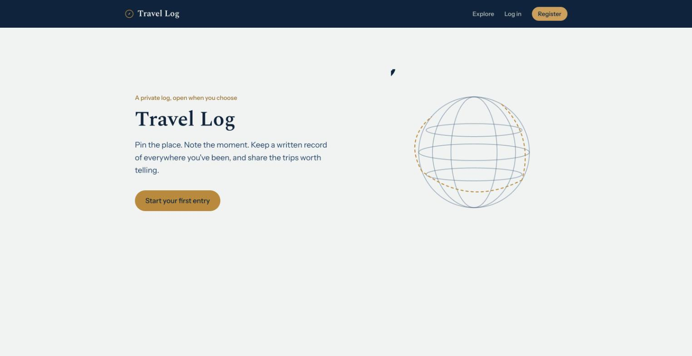
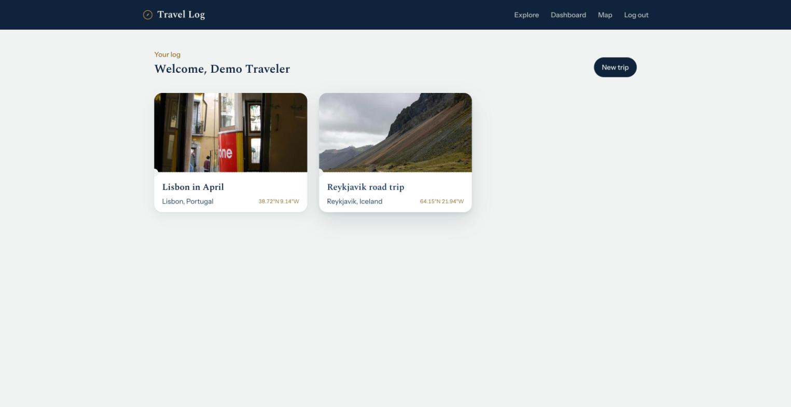
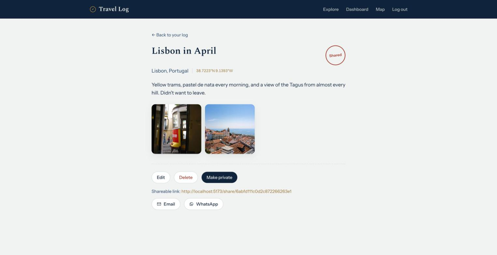
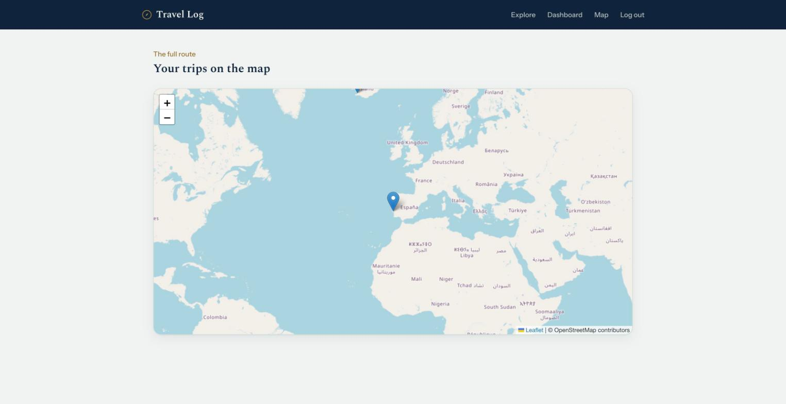
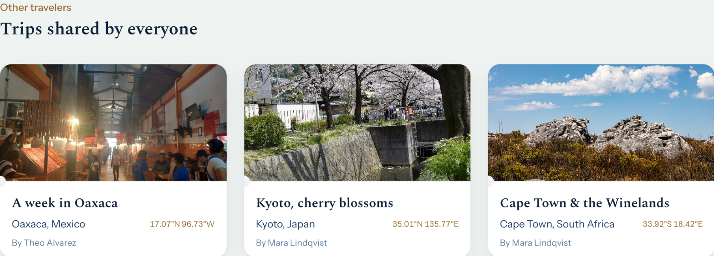
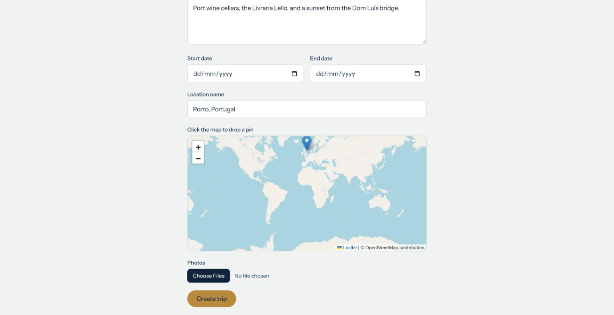
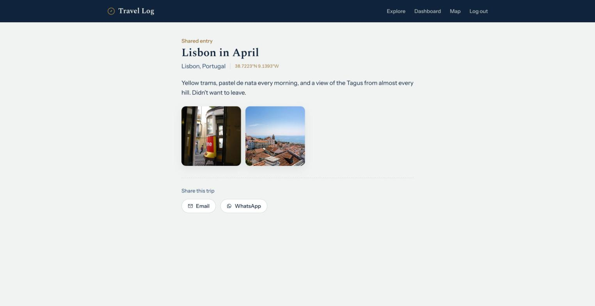

# Travel Log



**A full-stack MERN app for logging trips: pin where you went, write up what happened, attach photos, and share the trips worth telling via a public link.**

Built as a portfolio piece to show end-to-end full-stack ability — auth, file uploads, an interactive map, a REST API with proper ownership/visibility rules, and a polished, responsive UI — not just a CRUD skeleton.

## Features

- **Accounts & auth** — register/login with JWT auth and bcrypt-hashed passwords; protected routes redirect to login when signed out.
- **Trip logging** — title, description, date range, and a free-text location, created and edited through a single form.
- **Photo uploads** — attach jpeg/png/webp photos per trip (validated client- and server-side), stored via Multer and served statically.
- **Map pin picker** — click anywhere on a Leaflet/OpenStreetMap map to set a trip's coordinates; no geocoding API, no API key required.
- **Your trips, mapped** — a dedicated map view plots every trip you've logged as a pin; click one to jump to its detail page.
- **Public sharing** — toggle any trip public to get a no-login-required share link, plus one-click email/WhatsApp share buttons.
- **Explore page** — browse public trips shared by every traveler on the platform, not just your own.
- **Ownership enforcement** — the API 403s if you try to touch someone else's trip, and 404s (not 403) on private trips via the public endpoint, so it doesn't leak which private trips exist.

## Screenshots

| Dashboard | Trip detail |
|---|---|
|  |  |

| Map view | Explore (public trips) |
|---|---|
|  |  |

| New trip (map pin picker) | Public share link |
|---|---|
|  |  |

## Tech stack

**Frontend:** Vite, React, React Router, Tailwind CSS, TanStack React Query, Leaflet
**Backend:** Node, Express, MongoDB (Mongoose), JWT auth, bcrypt, Multer
**Testing:** Jest + Supertest (backend, against an in-memory Mongo instance), Vitest + React Testing Library (frontend)

## Architecture

```
client/        Vite + React SPA (React Router pages, React Query for server state)
server/        Express REST API
  src/models/        Mongoose schemas (User, Trip)
  src/controllers/    route handlers
  src/middleware/      auth (JWT), ownership checks, upload (Multer), error handling
  src/scripts/seed.js  demo data + photos
  uploads/            uploaded trip photos, served statically at /uploads
```

REST API surface:

```
POST   /api/auth/register        { name, email, password }
POST   /api/auth/login           { email, password } -> { token }
GET    /api/auth/me              (auth) current user profile

GET    /api/trips                (auth) list current user's trips
POST   /api/trips                (auth) create trip (multipart/form-data, photo upload)
GET    /api/trips/:id            (auth, owner-only) get one trip
PUT    /api/trips/:id            (auth, owner-only) update trip
DELETE /api/trips/:id            (auth, owner-only) delete trip

GET    /api/public/trips/:id     single public trip (no auth; 404 if not public or not found)

GET    /uploads/:userId/:filename   static file serving for photos
```

Auth is a JWT bearer token (7-day expiry), verified by Express middleware on every protected route. Trip ownership is checked separately so a logged-in user can't read, edit, or delete another user's trip.

## Local setup

### Backend

```bash
cd server
cp .env.example .env   # fill in MONGO_URI and JWT_SECRET
npm install
npm run dev             # http://localhost:5000
```

### Frontend

```bash
cd client
cp .env.example .env    # VITE_API_URL should point at the backend
npm install
npm run dev              # http://localhost:5173
```

### Demo data

```bash
cd server && npm run seed
```

Creates (or resets) three demo travelers with six sample trips between them, so the dashboard,
map, explore page, and share views all have realistic content to look at. Log in with
`demo@travel-log.app` / `password123` (two other demo accounts share the same password — see
the script output after seeding). Re-running the script replaces the demo accounts' trips (and
their photos) rather than duplicating them. Each trip ships with two real photos of the
destination (sourced from Wikimedia Commons, see `server/src/scripts/seed-photos/`) copied into
that user's uploads folder on seed.

### Tests

```bash
cd server && npm test
cd client && npm test
```

## Deployment

1. **Database:** create a free MongoDB Atlas cluster, copy its connection string into `MONGO_URI`.
2. **Backend (Render):** create a free web service pointed at `server/`, build command `npm install`, start command `npm start`. Set env vars `MONGO_URI`, `JWT_SECRET`, `CLIENT_ORIGIN` (your Vercel domain, once known).
3. **Frontend (Vercel):** import the repo, set the project root to `client/`, set env var `VITE_API_URL` to the Render backend's URL.
4. Once both are deployed, update the backend's `CLIENT_ORIGIN` env var to the live Vercel URL and redeploy the backend so CORS allows it.

**Known limitation:** Render's free tier uses an ephemeral filesystem, so photos uploaded to local disk are lost on redeploy or restart. This is an accepted tradeoff for a portfolio deployment — a future iteration could swap in Cloudinary or S3-backed storage without changing the API contract (`photos` stays an array of URL-like strings).
